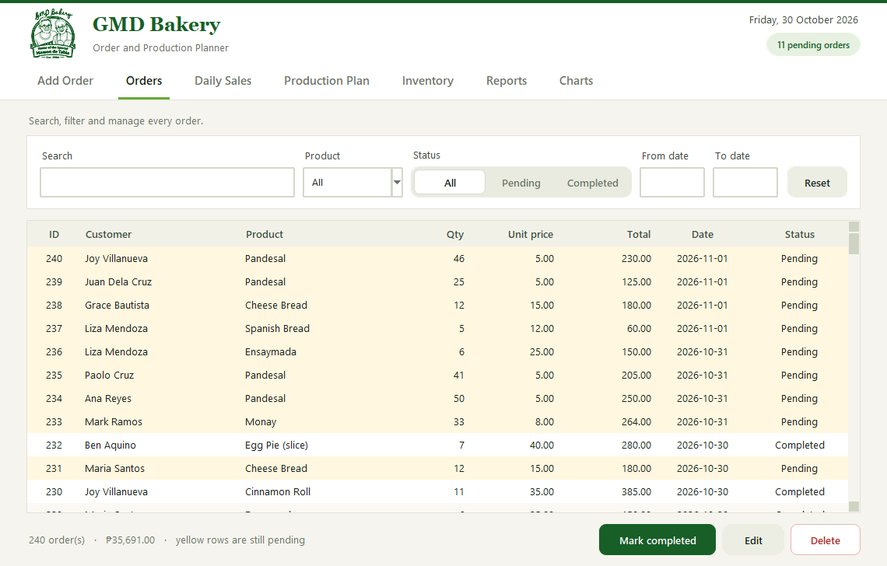
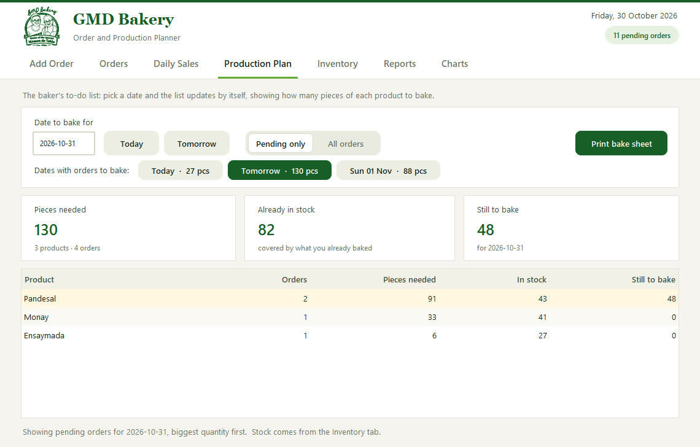
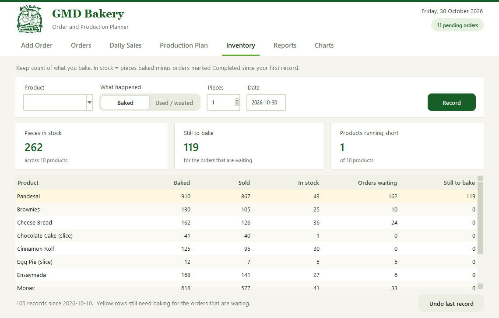
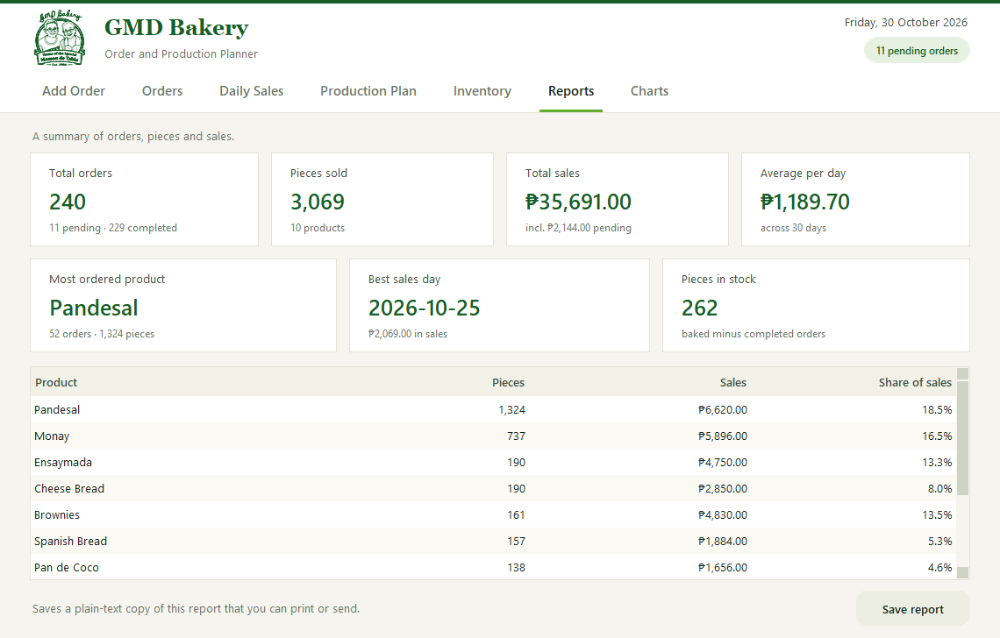
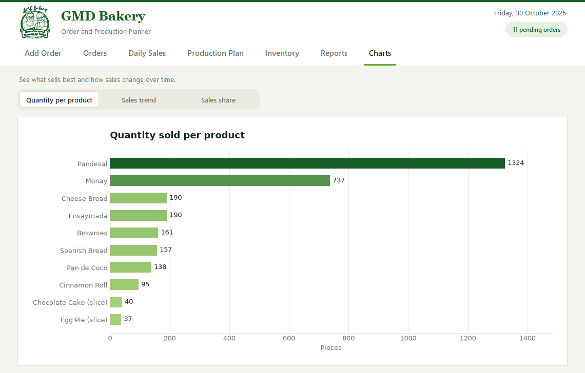

# GMD Bakery — Order and Production Planner

A simple program for recording bakery orders, keeping count of what you bake, planning what to
bake next, and seeing sales and charts. **No coding needed.**

Built for **GMD Bakery** (Home of the Special Mamon de Tabla, est. 1986) by **Ian Karvey L. Manimtim** — 2026.
Python · Tkinter · Matplotlib · CSV · PyInstaller.

**▶ Try it in your browser:** [karveyportfolio.vercel.app/projects/gmd-bakery-planner](https://karveyportfolio.vercel.app/projects/gmd-bakery-planner/)
(an interactive recreation with sample data)

> The ready-to-run Windows program (`dist\GMD Bakery Planner`) is attached to this repository's
> **Releases** page rather than stored in the code. All data in this repository is sample data —
> no real orders or customer details are included.

## Screenshots

Every screen below is the real program running on its built-in sample data.

| Production plan — what to bake, and how much is still short | Inventory — baked, sold and in stock |
|---|---|
|  |  |
| **Reports — totals, best day, best seller** | **Charts — quantity, sales trend and sales share** |
|  |  |

---

## Easiest way: the no-install version (no Python needed)

1. Copy the whole **`dist\GMD Bakery Planner`** folder to the computer (a USB flash drive is fine).
2. Open that folder and double-click **GMD Bakery Planner.exe**.

That's all. Nothing to install, no internet needed.

> **Windows says "Windows protected your PC"?** The program is not digitally signed, so Windows
> asks once. Click **More info**, then **Run anyway**. If an antivirus blocks it, choose to allow it.

The first start takes a few seconds (you will see a small "Starting up…" box). Later starts are quicker.

---

## The other way: run it with Python (run.bat)

Use this if you want to change the program itself.

**Step 1 — Install Python (one time only).** Skip if the computer already has it.
1. Go to **https://www.python.org/downloads/** and click the big yellow **Download Python** button.
2. Open the downloaded file.
3. **IMPORTANT:** at the bottom of the first screen tick **"Add python.exe to PATH"**.
4. Click **Install Now**, wait for "Setup was successful", then **Close**.

**Step 2 — Open the program.** Double-click **run.bat** in the program folder.
The first time it downloads two extra tools (about 1 minute, needs internet). After that it opens at once.

### Making the no-install version yourself
Only needed if you changed the code. Double-click **build_exe.bat** (needs Python and internet once,
takes about 2 minutes). The finished program appears in **dist\GMD Bakery Planner**.

---

## How to use it

Click the tabs at the top.

| Tab | What it does |
|---|---|
| **Add Order** | Type the customer name, pick a product (the price fills in by itself), set the quantity and the date it is needed, then click **Save order**. Press Enter to save quickly. |
| **Orders** | See every order. Type in the search box, or pick a product, status or dates, and the list narrows as you go. **Reset** clears everything. Click an order, then **Edit**, **Delete** or **Mark completed**. Yellow rows are still pending. |
| **Daily Sales** | Money earned on each day, with the best day and the daily average. |
| **Production Plan** | The baker's to-do list. It opens on the nearest date with pending orders. Click a date button (for example **Tomorrow · 37 pcs**) or type a date. It shows, for every product, how many pieces are **needed**, how many are **already in stock**, and how many are **still to bake** (yellow rows). **Print bake sheet** makes a printable page for that day. |
| **Inventory** | Keeps count of what you bake. Pick a product, choose **Baked** (or **Used / wasted**), enter the pieces and click **Record**. *In stock* = pieces baked minus orders you marked Completed since your first record. **Undo last record** fixes a mistake. |
| **Reports** | Totals for orders, pieces and sales (with how much is still pending), the most frequently ordered product (the one that appears in the most orders), the best day and the stock. **Save report** makes a printable text copy. |
| **Charts** | **Quantity per product** (bars), **Sales trend** (line, daily or weekly) and **Sales share** (pie). They always show your current orders. |

**Tips**
- Dates are written like this: **2026-10-12** (year-month-day).
- The program comes with **sample orders and sample baking records** so you can try everything.
  They are not real.
- A product you type that is not on the menu is remembered for next time, with its price.
- **Sales numbers include pending orders.** The cards show how much of the total is still pending.

### Keyboard shortcuts
| Keys | What happens |
|---|---|
| **Ctrl + 1 … 7** | Open tab 1 to 7 (Add Order, Orders, Daily Sales, Production Plan, Inventory, Reports, Charts) |
| **Ctrl + N** | Start a new order |
| **Ctrl + F** | Search the orders |
| **Tab** | Move between buttons, boxes and switches (a green ring shows where you are) |
| **Space** or **Enter** | Press the button you are on |
| **← →** | Change a switch (for example Pending / Completed) |

---

## Where your information is saved

| File | What is inside |
|---|---|
| **orders.csv** | Every order |
| **orders_stock.csv** | Your baking records (Inventory) |
| **exports** folder | Saved bake sheets and reports |
| **…last-session.bak** | A copy of the files as they were when the program was last opened |

The bottom of the program window shows exactly where **orders.csv** is. Usually it is in the same
folder as the program. If Windows blocks that folder, the program saves it in
`C:\Users\<your name>\AppData\Local\GMD-Bakery` instead, and keeps using it.

The program saves after every change, so you never need to press a "save" button for your data.

## Start fresh (remove the sample data)
1. Close the program.
2. Open **orders.csv** and **orders_stock.csv** with Notepad (right-click, **Open with**, **Notepad**).
3. In each one, delete everything **except the first line**, then save.

## Move it to another computer
Copy the **whole program folder** (or the **dist\GMD Bakery Planner** folder). Your orders travel with it
inside **orders.csv** and **orders_stock.csv** if they are in that folder. If the bottom of the window
shows the `AppData` path, copy those two files from there into the program folder first.

## The logo
The program shows the picture file called **GMD v2** (for example `GMD v2.jpg`) in the same folder.
To change the logo, replace that picture with another one that has the same name. If it is missing,
the program still works and just shows the name without a picture.

---

## Something went wrong?

| Problem | What to do |
|---|---|
| "Python is not installed" (run.bat) | Do Step 1 above, and make sure you ticked **Add python.exe to PATH**. Or use the no-install version. |
| It can't download the extra tools (run.bat) | Connect to the internet and double-click **run.bat** again. |
| "Cannot save" message | Close **orders.csv** if it is open in Excel, then try again. Nothing is lost. |
| I changed **orders.csv** in Excel while the program was open | Save and close Excel, then click back into the program. It picks up your changes. |
| "Some rows skipped" message | A few lines in a file are damaged. The program ignores them and keeps working. A copy of the original file is kept next to it, ending in **.bak**. |
| I want yesterday's data back | Next to **orders.csv** is a file ending in **.last-session.bak**. With the program closed, delete **orders.csv** and rename that file to **orders.csv**. (Do the same for the stock file.) |
| Nothing happens when I double-click | Right-click, choose **Run as administrator**. |
| The program starts slowly | The very first start on a computer takes longest. Antivirus programs also scan new programs the first time. |

*Using a Mac or Linux? Open a terminal in the folder and run:*
`python3 -m pip install -r requirements.txt` *then* `python3 bakery_planner.py`
